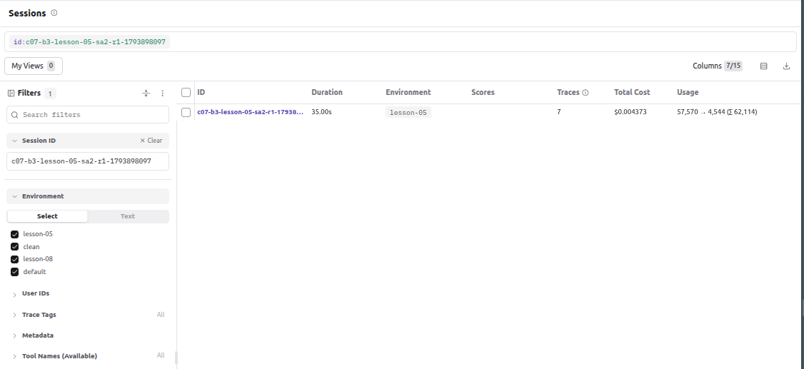
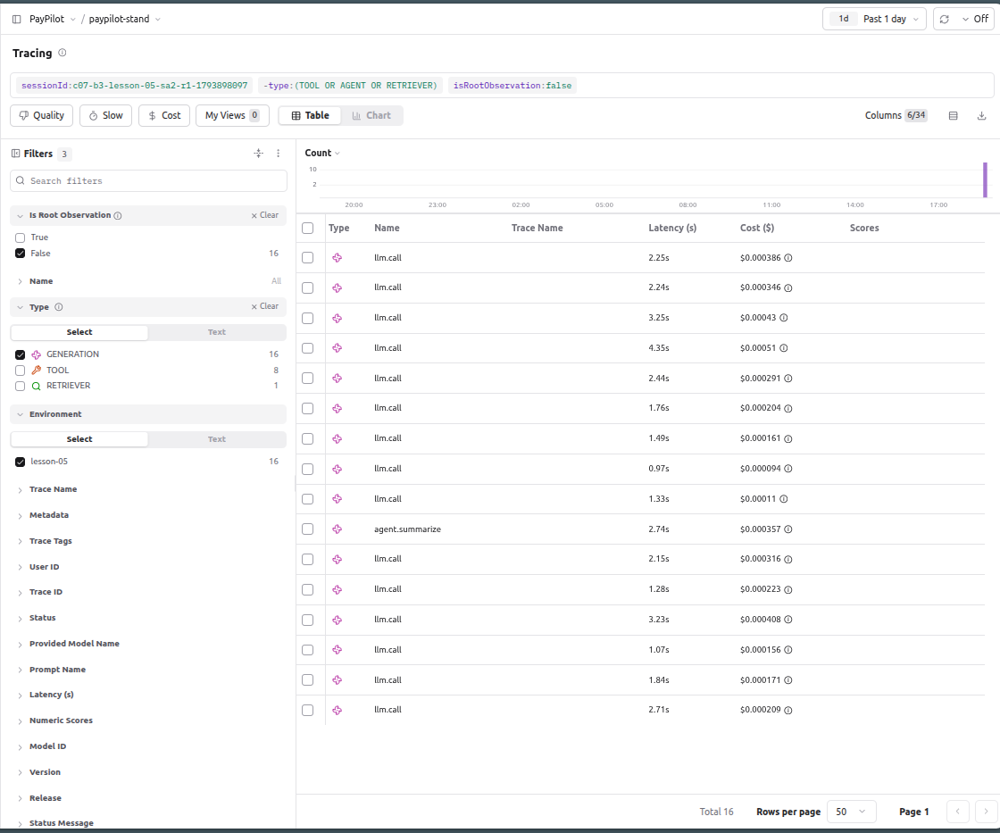
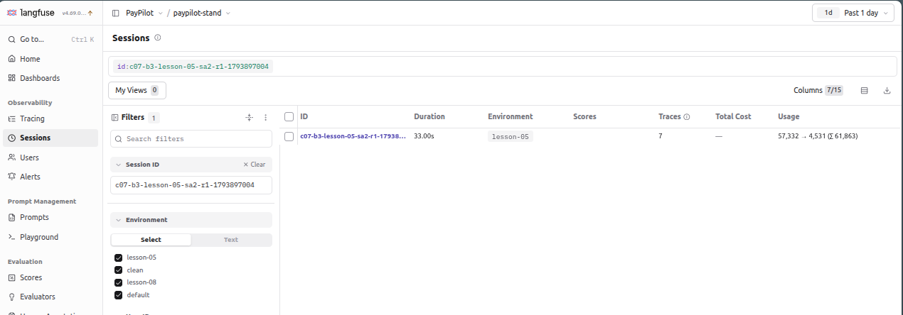
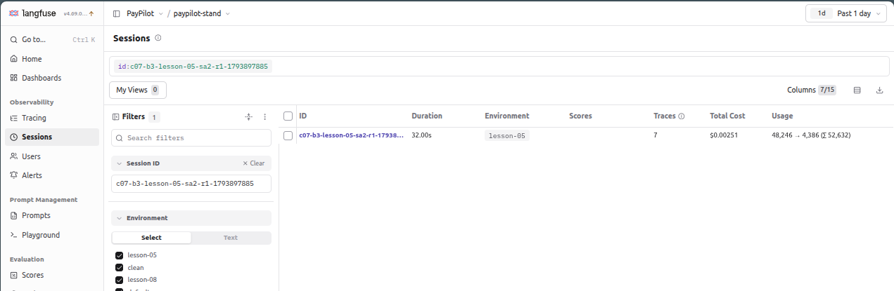

# Observability & Cost Report · PayPilot (Verta)

Система: PayPilot, стенд `paypilot-stand`, промпт `base.v1`. Модель: `anthropic/claude-haiku-5.5` через OpenRouter. Прайс зі стенду (`app/agent/pricing.py`, перевірено 2026-10-23): $0,10 / $0,50 за Мток (вхід / вихід), читання кешу ×0,1, запис у кеш ×1,25. Бекенд трейсів: Langfuse 4.69.0 (OTLP), дублюється у Phoenix і `traces.jsonl`. Заміри: 2026-11-05, C-07 = CONV-002 з `l05_dialogs.jsonl` (7 кроків, CUS-0004), 5 прогонів на умову, кожен з нової сесії; профіль і `summarize_after` задавалися заголовком `X-Stand-Settings`. Міряв скриптом по `GET /api/_test/traces/{request_id}` і Langfuse API (`/api/public/v2/observations`).

## Слайд 1 · Трейс проти лічильника

**Сесія в інтерфейсі трейсів:** скріншот робить автор звіту в Langfuse (Sessions → відкрити сесію → список із 7 кроків і колонка Total Cost, без розгорнутих деталей). Сесії для знімків (B3: профіль `lesson-05`, `summarize_after: 2`):

| Що показати | Session id | Total Cost у Langfuse | Рахунок провайдера |
|---|---|---|---|
| Основний знімок: визначення моделі з усіма відрами | `c07-b3-lesson-05-sa2-r1-1793898097` | $0,004373 | $0,004372 |
| Сліпа зона: без визначення моделі | `c07-b3-lesson-05-sa2-r1-1793897004` | порожньо («—»), у API `null` | $0,004898 |
| Сліпа зона: визначення лише input/output | `c07-b3-lesson-05-sa2-r1-1793897885` | $0,002510 | $0,004405 |

Тривалість сесії 35,00 с у Langfuse — це вікно від початку першого до кінця останнього кроку; сума латентностей кроків нижче 34,6 с.

Сліпа зона «без визначення моделі» (сесія `…1793897004`, B3, зняте до додавання визначення): токени є, Total Cost порожній.

Сліпа зона «визначення лише input/output» (сесія `…1793897885`): Total Cost виглядає правдоподібно, але занижений на 43% (рахунок провайдера $0,004405).

Ціна в Langfuse фіксується під час прийому трейсу, тому старі сесії лишаються з $0 і після додавання визначення моделі.

Total Cost по кроках сесії `c07-b3-lesson-05-sa2-r1-1793898097` (Langfuse API `/api/public/v2/observations`, сума генерацій кроку; корінь `agent.request` у таблиці Tracing ціни не має, бо Langfuse записує ціну на генераціях і до кореня її не підсумовує):

| Крок | Генерацій (включно з `agent.summarize`) | Час | Total Cost, Langfuse | Рахунок провайдера |
|---|---|---|---|---|
| 1 | 4 | 8,85 с | $0,000943 | $0,000943 |
| 2 | 2 | 3,44 с | $0,000539 | $0,000539 |
| 3 | 4 (з них `agent.summarize`) | 6,53 с | $0,000723 | $0,000723 |
| 4 | 1 | 1,76 с | $0,000204 | $0,000204 |
| 5 | 2 | 6,80 с | $0,000801 | $0,000801 |
| 6 | 1 | 3,25 с | $0,000430 | $0,000430 |
| 7 | 2 | 4,50 с | $0,000732 | $0,000732 |
| **Сума** | 16 | 34,6 с | **$0,004373** | **$0,004372** (розбіжність $0,000001 — округлення) |

**Карта сліпих зон:**

| Лічильник | Що показує | Що насправді | Звідки правда |
|---|---|---|---|
| `usage.cost_usd` у відповіді стенду | основні звернення до моделі за прайсом; B3: $0,004613 | не враховує виклик `agent.summarize` (і повтори D14). B3: −2,3% за медіаною (на сесії C2 −8,2%: там `agent.summarize` коштував $0,000357); `clean` з 10 кроків: $0,004738 проти $0,005694 (−17%) | `usage.provider_cost_usd` або сума `provider.cost_usd` спанів |
| Langfuse без визначення моделі | токени є (usage 57 332 → 4 531), Total Cost порожній («—», в API `null`) на всіх 15 генераціях сесії: Langfuse не попереджає, що ціни нема | ціна $0,004898 (рахунок провайдера за цю сесію). Вбудоване `claude-haiku-5-5` не збігається з назвою `anthropic/claude-haiku-5.5` (крапка замість дефіса), `modelId` порожній | визначення моделі в Settings → Models з `matchPattern` на `anthropic/claude-haiku-5.5` |
| Langfuse з визначенням лише input/output | $0,002510 | $0,004405 (−43%): відра `input_cached_tokens` (29 788 ток., $0,000298), `input_cache_creation_tokens` (2 708, $0,000339) і `output_reasoning_tokens` (2 515, $0,001258) без ціни рахуються як $0; разом $0,001895 і сума з показаним дає ціну провайдера до $1e-6 | визначення з усіма п'ятьма відрами: $0,004373 проти $0,004372 |
| Токени стиснення історії (`agent.summarize`) | не входять у `gen_ai.usage.total_*` кореня (B3: 52 089 проти 52 621 за спанами) і в `usage.cost_usd` | окремий виклик моделі: у C2 $0,000357, 8,2% ціни діалогу; у Langfuse він є як generation | спан `agent.summarize` (`gen_ai.usage.*`, `provider.cost_usd`) |
| Токени міркування (опційно) | `usage.output_tokens` і `gen_ai.usage.output_tokens` включають міркування; видимих символів відповіді вони не відображають | ~51% вихідних токенів C-07 на `clean` — міркування (медіана по прогонах). У Langfuse відро `output` його не містить, і без ціни `output_reasoning_tokens` ця частина = $0 | `gen_ai.usage.reasoning_tokens` у спані + ціна на відро |
| Langfuse, Tracing: колонка Cost на корені кроку (`agent.request`) | «—» на всіх 7 кроках сесії | ціна є на генераціях кроку (напр. крок 1: 4 генерації, $0,000943), до кореня Langfuse її не підсумовує | фільтр Type = GENERATION або сума генерацій за `traceId` (таблиця вище) |

**Розбір інциденту. Сценарій:** клієнт CUS-0004 називає транзакцію TX-0401 на 240,00 EUR (товар не прийшов) і питає код причини (крок 1), чи можна оскаржити (2), перемикається на ліміт (3) і спред FX (4), повертається до спору (5 «що далі?», 6 «240 євро, як я казав на початку», 7 «ще встигаю?»). До кроку 7 мають дожити чотири сутності: **TX-0401, 240,00 EUR, `goods_not_received`, дедлайн 2026-10-18**. Профіль `lesson-05` (D06 + D07), `summarize_after: 2`. Сесія `c07-b3-lesson-05-sa2-r1-1793898097`.

| Крок | Спан | Що в ньому записано | Де розійшлося |
|---|---|---|---|
| 1 | `llm.call` ×4, `tool.search_knowledge_base`, `get_account`, `get_transactions` | відповідь: TX-0401, 240,00 EUR, `goods_not_received`, 90 днів, ~2026-10-18 | усі чотири сутності на місці |
| 2 | `llm.call` ×2, `tool.check_dispute_eligibility` {TX-0401, goods_not_received} → `eligible: true, deadline: 2026-10-18` | відповідь: TX-0401, 240,00 EUR, 2026-10-18 | усі на місці |
| 3 | **`agent.summarize`** (`replaced_messages: 12`, `e62f478345ee4953`, трейс `9add0102e5e04822`) | `summary.input` (3 642 симв.) містить TX-0401, 240,00 EUR, `goods_not_received`, 2026-10-18. `summary.text` (488 симв.): «a card payment to an online merchant … the matching code was confirmed … a similar earlier payment … flagged as a possible service_not_rendered» | **TX-0401, 240,00 EUR, `goods_not_received` і дедлайн зникли тут.** Натомість з'явилася згадка про «схожий платіж, позначений як `service_not_rendered`»: у `summary.input` це відповідь кроку 1 про TX-0402 з кодом `duplicate_charge`, у `summary.text` код уже інший |
| 3 | `llm.call` ×3, `get_account`, `check_limits` | відповідь про ліміт, спор «ще чекає підтвердження» | сутності вже нема, але крок про ліміт цього не показує |
| 4 | `llm.call` ×1 | «яку суму конвертувати?» | не стосується спору |
| 5 | `llm.call` ×2, `tool.get_transactions` | «одна з двох платежів по 240,00 EUR: TX-0402 і TX-0401, **не можу сказати, яка**» | **перше місце, де втрату видно клієнту:** агент не знає, про яку транзакцію мова, і лізе в базу |
| 6 | `llm.call` ×1 | «обидва платежі по 240, назвіть ID» | та сама втрата |
| 7 | `llm.call` ×2, `check_dispute_eligibility` для TX-0402 і TX-0401 | дедлайни обох: 12 і 18 жовтня | агент ганяє перевірку по двох транзакціях замість однієї |

**Що було у вході генерації на кроці, де розійшлося:** на кроці 3 `summary.input` містив ранню частину діалогу з TX-0401, `240.00 EUR`, `goods_not_received`, `deadline: 2026-10-18` і `duplicate_charge` (двічі: рядок таблиці вікон із відповіді бази знань і відповідь кроку 1, де агент радить розглянути `duplicate_charge` для TX-0402), а `summary.text` на виході не містить жодного з цих значень. З цього тексту (`(summary of earlier conversation)`) починається вхід `llm.call` на кроці 5: в ньому вже немає ні TX-0401, ні 240, ні дедлайну, тому агент перепитує транзакцію.

Одним реченням для регулятора: на спані `agent.summarize` кроку 3 (`e62f478345ee4953`) із зведення, що замінило перші 12 повідомлень, зникли ідентифікатор транзакції TX-0401, сума 240,00 EUR, код причини `goods_not_received` і дедлайн 2026-10-18, а замість `duplicate_charge`, згаданого для TX-0402, з'явився код `service_not_rendered`, якого в діалозі ніхто не називав (D07 підміняє коди причин у зведенні, `app/agent/summarize.py`).

Про повторюваність: у 5 з 5 прогонів B3 у `summary.text` немає TX-0401 і суми 240; код причини зник у 4 з 5 і був підмінений на `service_not_rendered` у 2 з 5; дедлайн зник у 5 з 5. Видима відповідь це не завжди виявляє: на кроці 5 перевірка «240 і `goods_not_received`» пройшла в 5 з 5, бо агент відновлює їх з інструментів, а дедлайн кроку 7 втрачено в 1 з 5 (прогін 4), на кроці 5 хибний `duplicate_charge` згадано в 1 з 5 (прогін 5, як альтернативу). У контролі `clean` + `summarize_after: 2` усі чотири сутності в `summary.text` збереглися 5 з 5. Ціна втрати: 7 викликів інструментів замість 4 і 35,1 с замість 22,6 с на `clean`, але контроль `clean` + `sa=2` дає 31,2 с, тож частину цього дає сама рання згортка, а не дефект.

**Зауваження про кіт B3:** сам кіт B3 у репозиторії відсутній, C-07 узято з `l05_dialogs.jsonl`. Код причини клієнта в ньому `goods_not_received`, а `duplicate_charge` потрапляє у вхід згортки через відповідь агента про TX-0402 і таблицю вікон з бази знань, тобто це вибір моделі, а не слова клієнта. У різних прогонах агент може цю згадку не робити (у прогоні 1 її не було), тож рядок «Що було у вході» зафіксовано на сесії `c07-b3-lesson-05-sa2-r1-1793898097`. Якщо кіт B3 задає інший діалог, його треба перезняти.

**Ціна з трьох джерел** (гроші за діалог, медіана з 5 прогонів):

| Сценарій | Умова | Самозвіт системи | Сума спанів | Рахунок провайдера | Звірка |
|---|---|---|---|---|---|
| C-07 | clean | $0,003248 | $0,003248 | $0,003246 | збіглося (розбіжність ≤ $0,000002, округлення) |
| C-07 | lesson-08 | $0,004445 | $0,004445 | $0,004444 | збіглося: D14 не спрацював, повторних `loop_step` нема, а replay D15 (його токени) іде в основні виклики |
| C-07 | lesson-05, `summarize_after: 2` (B3) | $0,004613 | $0,004722 | $0,004722 | **самозвіт нижчий на $0,000109 (2,3%)**: не рахує `agent.summarize`; сума спанів і рахунок провайдера збіглися |
| B1 (D14, CUS-0003, 2 кроки; кіт L08) | clean | $0,000330 | $0,000329 | $0,000329 | збіглося (≤ $0,000001) |
| B1 (D14, CUS-0003, 2 кроки; кіт L08) | D14 | $0,000481 | $0,001889 | $0,001889 | **самозвіт нижчий на $0,001408 (−75%, у 3,9 раза)**: не рахує 7 повторів `get_transactions` (повтори D14); сума спанів збіглася з рахунком провайдера, бо повтори є спанами `llm.call` |
| B2 (D15, CUS-0004, 7 кроків; кіт L08) | clean | $0,004663 | $0,004662 | $0,004662 | збіглося (≤ $0,000001) |
| B2 (D15, CUS-0004, 7 кроків; кіт L08) | lesson-08 | $0,005461 | $0,005462 | $0,005462 | збіглося (≤ $0,000001): replay D15 іде в основні виклики |

**Ціна сценарію** (гроші — з трейсу, не з поля відповіді; норма = `clean`, поточна збірка = `lesson-08`; медіана з 5 прогонів):

| | норма | поточна збірка | співвідношення |
|---|---|---|---|
| Вхідні токени, медіана | 43 108 | 56 414 | ×1,31 |
| Час, медіана | 22,6 с | 21,9 с | ×0,97 |
| Ціна, медіана | $0,003246 | $0,004444 | ×1,37 |

Розкид `lesson-08` великий (вхід 37 297–64 614 ток., ціна $0,002825–$0,005425), діапазони з `clean` ($0,002878–$0,003904) перетинаються, тому співвідношення — оцінка за 5 прогонами, а не точне значення.

**Ціна ще двох сценаріїв** (кіт L08, `b4.json`, haiku-5.5, медіана з 5 прогонів; норма = `clean`, поточна збірка = умова з дефектом):

| | B1 · норма | B1 · D14 | співвідношення | B2 · норма | B2 · lesson-08 | співвідношення |
|---|---|---|---|---|---|---|
| Вхідні токени, медіана | 11 116 | 33 501 | ×3,01 | 62 462 | 69 997 | ×1,12 |
| Час, медіана | 4,8 с | 19,8 с | ×4,14 | 23,8 с | 23,8 с | ×1,00 |
| Ціна, медіана | $0,000329 | $0,001889 | ×5,74 | $0,004662 | $0,005462 | ×1,17 |

Три сценарії дають різні профілі дефекту: D14 б'є по часу й ціні (×4,1 і ×5,7 на двох кроках), D15 лише по токенах і ціні (×1,12–1,37) і майже не чіпає час.

## Слайд 2 · Прогноз

Модель: `anthropic/claude-haiku-5.5` через OpenRouter. Прайс зі стенду (`app/agent/pricing.py`, перевірено 2026-10-23): $0,10 / $0,50 за Мток (вхід / вихід), читання кешу ×0,1, запис у кеш ×1,25. Сценарій: C-07 (CONV-002, 7 кроків, CUS-0004). Заміри: 5 прогонів на умову, нова сесія на прогін, 2026-11-05. Ціна нижче — це рахунок провайдера (`provider.cost_usd`); сума спанів за прайсом збіглася з ним до 1e-6.

| Поверх | Значення | Звідки (виміряно / розраховано) |
|---|---|---|
| Спан (`llm.call`), медіана | clean $0,000281; lesson-08 $0,000350 (по 56 спанів) | виміряно, трейс |
| Крок діалогу, медіана | clean $0,000448; lesson-08 $0,000561 | виміряно, трейс (сума спанів кроку) |
| Сценарій C-07 (діалог), медіана | clean $0,003246 / 22,6 с / 43 108 вх. токенів; lesson-08 $0,004444 / 21,9 с / 56 414 вх. токенів | виміряно, 5 прогонів на умову |
| Місяць, 800 користувачів, 4 діалоги на користувача | clean $10,39; lesson-08 $14,22 | розраховано з припущень нижче |
| Прогноз, формула для N | див. нижче | розраховано |

**Припущення** (заміряне й припущення не змішую):

| Припущення | Значення | Джерело | Тип |
|---|---|---|---|
| Активні користувачі | 800 | умова завдання (крок №2) | задано |
| Діалогів на користувача на місяць | 4 (чутливість: 2 і 8) | немає, потрібне джерело (статистика звернень) | припущення |
| Мікс сценаріїв | 100% діалогів ≈ C-07 (7 кроків, ~11 викликів моделі) | немає, потрібне джерело. Верхня оцінка: C-07 довший за типове звернення | припущення |
| Ціна діалогу | clean $0,003246; lesson-08 $0,004444 | заміри вище | заміряно |

**Місяць для поточної кількості користувачів, поточна модель:** 800 × d × ціна діалогу, де d діалогів на користувача на місяць.

| d (припущення) | Діалогів на місяць | clean (норма) | lesson-08 (поточна збірка) |
|---|---|---|---|
| 2 | 1 600 | $5,19 | $7,11 |
| 4 | 3 200 | $10,39 | $14,22 |
| 8 | 6 400 | $20,77 | $28,44 |

Для порівняння: прогноз за самозвітом стенду (`usage.cost_usd`) на C-07 дає ті самі $0,003248 і $0,004445, бо на 7 кроках без стиснення поля збігаються. Розбіжність з'являється, коли в діалозі спрацьовує згортка (див. нижче).

**Формула для N:** місяць = N × d × P(L), де P(7) = $0,003246 (clean) або $0,004444 (lesson-08) для діалогу з 7 кроків. Лінійна частина: +1 користувач = +d × P, тобто $0,013 (clean) / $0,018 (lesson-08) за місяць при d = 4. Зростання з 800 до 1000 користувачів дає +25%.

**Що росте швидше за N:** довжина діалогу L, а не кількість користувачів.
- **Ціна діалогу від L.** Той самий діалог, подовжений із 7 до 10 кроків (CONV-003): clean $0,003246 → $0,005694, тобто ×1,75 за ×1,43 довжини (показник ≈ 1,6 за двома точками, 3 прогони на довшому діалозі). Причина: кожен виклик моделі заново надсилає історію (медіана входу на кроках clean: 5,9k токенів на кроці 1, 9,2k на кроці 6). Тобто при незмінному N зміна середньої довжини з 7 до 10 кроків дає +75%, а ріст N на 25% дає +25%.
- **D15 (тихий).** Replay результатів інструментів: lesson-08 дорожчий за clean на 37% при 7 кроках і на 31% при 10, а абсолютна надбавка росте з довжиною ($0,0012 → $0,0018 за діалог). Відсоток майже не змінюється, бо після кроку 8 спрацьовує згортка (вхід падає з ~5,2k до ~3,4k токенів). Розкид великий (вхід lesson-08 на 7 кроках від 37k до 65k), діапазони з clean перетинаються.
- **Згортка історії (тихий).** Виклик `agent.summarize` ($0,00096 на діалог із 10 кроків) не входить у `usage.cost_usd`. Розрив самозвіту: на 10 кроках clean $0,004738 проти $0,005694 за провайдером (−17%), на lesson-08 −13%. Чим довші діалоги, тим частіше згортка, тим більший розрив. Прогноз із самозвіту занизить місяць.
- **D14 (повтори на порожній результат).** У C-07 жоден результат інструмента не порожній, повторних `loop_step` у 20 діалогах C-07 не було, тож місячна ціна вище на нього не чутлива. Виміряно окремо на сценарії «порожня історія» (слайд 3, S2): кожен порожній результат дає 7 повторів того самого виклику, діалог з 2 кроків коштує $0,002544 проти $0,000642 (×4,0), час ×3,2, а `usage.cost_usd` показує $0,000855, тобто втричі менше за рахунок провайдера. Росте D14 з кількістю порожніх результатів у діалозі, а не з N або довжиною діалогу, тому частка таких діалогів у міксі — додатковий параметр прогнозу, джерела якого немає.

**За яких умов прогноз зміниться:** середня довжина діалогу (найсильніший важіль, див. вище); мікс сценаріїв (короткі звернення здешевлять місяць, довгі подорожчають); діалогів на користувача (тепер припущення); прайс моделі (дата 2026-10-23) і довгий тариф понад 100k вхідних токенів; поріг згортки (`summarize_after`, у стенді 8: на 2 діалог дорожчає й подовжується навіть на `clean`, див. слайд 1).

## Слайд 3 · Рішення

Заміри: 2026-11-05, haiku-5.5 через OpenRouter, по 5 прогонів на комірку (де не сказано інше), ціна — рахунок провайдера (`provider.cost_usd`). Порядок: спершу виправлення дефектів, потім рішення, які щось обмінюють.

| Важіль | Що дає | Що псується |
|---|---|---|
| **1. Виправлення D15**: не підмішувати в кожну репліку результати попередніх інструментів (replay) | C-07: $0,004444 → $0,003246 (−27%), вхідні токени 56 414 → 43 108 (−24%), час без змін (21,9 → 22,6 с). Розкид великий, діапазони перекриваються (lesson-08: $0,002826–0,005425; clean: $0,002878–0,003903) | нічого не обмінюємо. Ризик один: регресія контексту, тому після правки повний набір (інваріанти C-07 5/5) і бюджет `C07-BUDGET` |
| **2. Виправлення D14**: не повторювати виклик, який повернув порожній результат | S2 «порожня історія» (2 кроки): $0,002544 → $0,000642 (−75%), час 23,3 → 7,2 с (−69%), однакових викликів у кроці 8 → 1, вхід 35 853 → 14 241 токенів | нічого не обмінюємо для детермінованого порожнього результату. Не виміряно: тимчасовий збій інструмента без повтору; тоді агент має чесно сказати про недоступність або ескалювати |
| **3. Рішення: вимкнути міркування** (`reasoning: off`) | C-07: $0,003246 → $0,002837 (−13%), час 22,6 → 17,8 с (−21%), вихідні токени 2 870 → 1 873; інваріанти C-07 5/5 | пояснюваність (тексту міркування нема). Точність першого виклику: у 2 з 5 прогонів інструмент викликано з хибними аргументами (`get_account` з `account_id: "None"`, `get_transactions` з `account_id: CUS-0004`), викликів інструментів 5 (3–7) проти 4. Ціновий розкид ширший ($0,002344–0,003974 проти $0,002878–0,003903), тож −13% лежить у межах розкиду |
| **4. Рішення: пізніше стиснення** (`summarize_after` 20 замість 8) | діалог із 10 кроків (CONV-003), 3 прогони: $0,005694 → $0,005048 (−11%), час 37,0 → 28,5 с (−23%); виклик згортки ($0,00096) у цьому діалозі коштує більше, ніж дає | довші діалоги без згортки: контекст росте далі, на довжинах понад 10 кроків не виміряно. Діапазони перекриваються ($0,005604–0,006739 проти $0,004754–0,005796), 3 прогони — передчасно |
| **5. Рішення: раннє стиснення** (`summarize_after` 2) | на C-07 не дає економії: $0,003246 → $0,004539 (+40%), час 22,6 → 31,2 с (+38%) | пам'ять і гроші: на D06/D07 сутності зникають 5 з 5 (слайд 1), агент перепитує втрачене |
| **6. Рішення: перейти з gemini-2.5-flash на haiku-5.5** (B4 кіта) | дешевше за діалог на 17–36% на baseline (B1 $0,000513 → $0,000329, B2 $0,005634 → $0,004662), гейт D15 знову ловить дефект (на gemini поріг 6 500 його пропускає); стабільніше в хвостах D14 (haiku max $0,001927, gemini до $0,0635) | повільніше на 39% (B1) і 81% (B2), у 5,8 раза більше вихідних токенів міркування; запас гейту B2 на haiku 1,7%; дефекти D14/D15 переїдуть, якщо їх не виправлено, див. «Міграція моделі» |

Клас: важелі 1 і 2 — виправлення (усувають дефект, схвалення не потрібне, лише регресія), 3–6 — рішення. Схвалює рішення власник продукту разом із QA.

- **Що обміняли:** виправлення D14 і D15 нічого не обмінюють і береться першим кроком. Обмін, який пропонується, але не схвалений: пояснюваність і точність першого виклику інструмента за ~13% ціни і ~21% часу (`reasoning: off`). Схвалення — власник продукту з QA, поки без рішення: економія лежить у межах розкиду.
- **Чого не робимо:** не переходимо на haiku-5.5, поки не виправлено D14 і D15 (інакше дефекти переїдуть на новий прайс і ціна проблеми лише змінить масштаб); не ставимо `summarize_after: 2` (дорожче й губить сутності); не лишаємося на gemini-2.5-flash з порогом кіта B2 6 500 (він пропускає D15); не ставимо `latency_ms` на C-07 (D15 час не збільшує: 21,9 проти 22,6 с); не рахуємо місяць за `usage.cost_usd` (на B1 з D14 він занижує ціну в 3,9–4,6 раза: haiku $0,000481 проти $0,001889, gemini $0,000923 проти $0,004216 за рахунком провайдера).
- **За яких умов рішення зміниться:** мікс сценаріїв (більше діалогів із порожніми результатами підвищує вагу D14); довжина діалогу (при 10+ кроках пізніша згортка може виграти більше; виміряти на 15–20 кроках); зміна прайсу (дата 2026-10-23) або появи довгого тарифу понад 100k токенів; нові дефекти; умови рішення про модель див. у «Міграція моделі».

### Міграція моделі

**Було → хочемо:** `google/gemini-2.5-flash` → `anthropic/claude-haiku-5.5` (сценарій B4 кіта L08, `scenarios/b4-migration.json`, репозиторій `sergeytkachenko/paypilot-l08-eval`, коміт `666e496`). Сценарії B1 (D14, CUS-0003, 2 кроки) і B2 (D15, CUS-0004, 7 кроків) за кітом, умови `baseline` (clean) і `defect` (B1: D14, B2: `lesson-08`), по 5 прогонів на умову, обидві моделі через OpenRouter, міркування типове для кожної, 2026-11-05. Ранер кіта сам рахує ціну зі спанів; тут $ діалогу — рахунок провайдера (`provider.cost_usd`), він збігається зі сумою спанів за `prices.json`. Сирі результати: [b4.json](b4.json). Прайс (`prices.json`, перевірено 2026-10-23), $ за Мток вхід / вихід: gemini-2.5-flash $0,30 / $2,50 (запис у кеш ×0,3778 всередині читання), haiku-5.5 $0,10 / $0,50 (читання кешу ×0,1, запис ×1,25).

| Модель | Сценарій | Умова | $ діалогу, медіана (розкид) | Час діалогу, медіана (розкид) | Перевірка 1 | Перевірка 2 | Токени (довідково, токенізатори різні) |
|---|---|---|---|---|---|---|---|
| gemini-2.5-flash | B1 D14 | baseline | $0,000513 (0,000503–0,000636) | 3,4 с (3,2–5,5) | однакових викликів ≤1: 5/5 | `get_transactions` на кроці 2: 5/5 | вх. 6 407, вих. 76 |
| gemini-2.5-flash | B1 D14 | defect | $0,004216 (0,001855–**0,063542**) | 16,8 с (9,5–**93,1**) | **0/5** (96 однакових викликів) | 5/5 | вх. 35 884, вих. 419 |
| haiku-5.5 | B1 D14 | baseline | $0,000329 (0,000315–0,000626) | 4,8 с (4,5–5,3) | 5/5 | 5/5 | вх. 11 116, вих. 245 |
| haiku-5.5 | B1 D14 | defect | $0,001889 (0,001709–0,001927) | 19,8 с (19,0–20,5) | **0/5** (8 однакових викликів) | 5/5 | вх. 33 501, вих. 2 055 |
| gemini-2.5-flash | B2 D15 | baseline | $0,005634 (0,005313–0,005888) | 13,1 с (12,3–14,0) | вхід першого виклику кроку 6, медіана ≤ 6 500: **PASS** (3 101) | `replay` 0/5 | вх. 32 160, вих. 480 |
| gemini-2.5-flash | B2 D15 | defect (lesson-08) | $0,007288 (0,006979–0,008927) | 12,3 с (11,3–14,6) | **PASS** (3 705): D15 є, гейт зелений | `replay` 5/5 | вх. 35 479, вих. 547 |
| haiku-5.5 | B2 D15 | baseline | $0,004662 (0,004148–0,004912) | 23,8 с (22,7–25,5) | **PASS** (6 388) | `replay` 0/5 | вх. 62 462, вих. 2 788 |
| haiku-5.5 | B2 D15 | defect (lesson-08) | $0,005462 (0,004383–0,006316) | 23,8 с (22,0–26,2) | **FAIL** (7 329): D15 піймано | `replay` 5/5 | вх. 69 997, вих. 2 830 |

Перевірки кіта: `identical_tool_calls_max` ≤1 у межах одного кроку (рівень 1) і `tool_called` get_transactions на кроці 2 (передумова, рівень 1) для B1; `first_call_input_tokens_median_max` на кроці 6, поріг 6 500, вердикт за медіаною 5 прогонів (рівень 2) для B2. У колонці «Перевірка 2» для B2 стоїть не перевірка кіта, а діагностика: `context.replay_active` у корені трейсу. Три ціни збіглися на baseline обох моделей; на B1 з D14 самозвіт стенду нижчий за рахунок провайдера: gemini $0,000923 проти $0,004216 (у 4,6 раза), haiku $0,000481 проти $0,001889 (у 3,9 раза).

- **Що дешевше за діалог:** haiku. B1 baseline на 36% ($0,000513 → $0,000329), B2 baseline на 17% ($0,005634 → $0,004662, діапазони не перекриваються: 5 313–5 888 проти 4 148–4 912). З дефектами B2 дешевша на 25% ($0,007288 → $0,005462), B1 за медіаною на 55% ($0,004216 → $0,001889), але медіана gemini ховає хвіст: у найгіршому прогоні $0,063542 (×124 до baseline), 93 с, 96 однакових викликів, а в haiku діапазон вузький ($0,001709–0,001927). Напрям збігається з прайсом: gemini дорожча в ×3 за вхід і ×5 за вихід. Ціною виграшу стає час: haiku повільніша на 39% на B1 (3,4 → 4,8 с) і на 81% на B2 (13,1 → 23,8 с), і пише в 5,8 раза більше вихідних токенів (2 788 проти 480 на B2), це її міркування.
- **Що лишилося зеленим:** baseline обох сценаріїв зелений на обох моделях (B1 5/5, B2 PASS), після міграції не почервоніла жодна перевірка кіта. D14 ловиться на обох (0/5 на обох моделях). D15 ловиться лише на haiku (B2 FAIL, 7 329 проти порогу 6 500), а на gemini той самий поріг пропускає D15 (3 705, `replay` 5/5), тож міграція на haiku повертає гейту D15 зуби.
- **Чого перевірки не бачать:** (1) час діалогу: +39% і +81% не охороняє жодна перевірка (`dialog_latency_ms_max` у кіті є, але в B1 і B2 не заданий); (2) запас гейту B2 на haiku мізерний: медіана baseline 6 388 лише на 112 токенів (1,7%) нижче порогу, а один із п'яти прогонів baseline (6 509) уже вище, тож це перевірка за порогом, не доказ; (3) хвіст D14 на gemini (до $0,0635 і 93 с) за медіаною не видно; (4) запис без підтвердження клієнта: кіт цього не перевіряє, у моїх власних сценаріях (нижче) gemini відкриває спір сама в 9 прогонах із 10 проти 0 з 10 у haiku; (5) зміст відповідей (тон, повнота пояснень) і те, чи не стали відповіді haiku, яка пише в 5,8 раза більше токенів міркування, довшими без користі; (6) стан бази між прогонами скидається ранером кіта, а в моїх власних прогонах ні.
- **Рішення: переходимо за умови.** Умови: (а) спершу виправлено D14 і D15 на haiku (інакше дефекти переїдуть на іншу модель, див. «Чого не робимо»), регресія B1 5/5 і B2 PASS на haiku; (б) власник продукту схвалює повільніші діалоги (+39% на 2 кроках, +81% на 7 кроках), інакше виграш у ціні (17–36%) не вартий переходу; (в) поріг B2 6 500 перезнято на 5+ прогонах із ширшим запасом, бо зараз 1,7%; (г) у кейси додано перевірку «жодного `create_dispute` до підтвердження клієнта» (мій V4). Рішення зміниться, якщо: прайс haiku зросте (дата прайсу 2026-10-23), час діалогу виявиться критичним для клієнта, або мікс сценаріїв зсунеться до коротких діалогів (на 2 кроках виграш у ціні в абсолютних числах мізерний: $0,000184 за діалог).
- **Пороги перезняти:** усе, що зняте на tokens haiku-5.5, прив'язане до її токенізатора. Поріг кіта B2 (6 500 на вхід першого виклику кроку 6) на gemini осліпнув: baseline 3 101 (2 860–3 165), defect 3 705 (3 651–3 743), гейт зелений при D15; поріг між 3 165 і 3 651 розділив би всі 10 прогонів, запас вибирається окремо. Мої бюджети з кроку 4 (`C07-BUDGET` 57 450, `CONV003-BUDGET` 84 010, `CONV004-BUDGET` 32 290 токенів, `S2-D14-BUDGET` 18 680 токенів і 9 020 мс) зняті на haiku, тобто на моделі, на яку переходимо, а на gemini їх довелося б перезняти (на моєму C-07 gemini clean 30 483 токенів проти 45 957 у haiku, поріг 57 450 осліпне). `identical_tool_calls_max: 1` переносимий між моделями, бо не залежить від токенізатора. Бюджети не переносити, а перезнімати з датою і моделлю baseline.

- **Що лишилося невиміряним** (іде судді на L09): (1) чи крок 5 C-07 пояснює «що далі» повно і правильно (названо TX-0401, суму, код, вимогу підтвердити) — детерміновано видно лише суму й код; (2) чи відповідь у S2 чесно розрізняє «історія порожня» і «система недоступна», не стверджуючи «активності не було»; (3) чи відмова gemini «акаунта не існує» вводить клієнта в оману; (4) тон і повнота відповіді на кроці 7 (дедлайни обох TX-0401/0402, коли клієнт не уточнив); (5) чи gemini-відповіді «goods were not received» семантично рівні коду `goods_not_received`; (6) чи пояснення без міркування (`reasoning: off`) не гірші за довші; (7) чи довші відповіді haiku на B2 (2 788 вихідних токенів проти 480) дають клієнтові більше, ніж коротші відповіді gemini.

#### Додаткові заміри на власних сценаріях (haiku-5.5 і gemini-2.5-flash)

Окрім B1 і B2 я міряв дві власні розмови: **S1** C-07 (CONV-002, 7 кроків, CUS-0004) і **S2** «порожня історія» (CUS-0003, 2 кроки: «покажи останні транзакції», «а картки за місяць?»). По 5 прогонів, 2026-11-05, `clean` і `lesson-08`, ті самі моделі через OpenRouter, ціна — рахунок провайдера. Тут напрям спостерігається у зворотний бік, але таблиця симетрична: порівнюйте стовпці моделей. Вони ширші за B1/B2 і показали те, чого кіт не міряє.

| Модель | Сценарій | Умова | $ діалогу, медіана (розкид) | Час діалогу, медіана (розкид) | Перевірка 1 | Перевірка 2 | Токени (довідково, токенізатори різні) |
|---|---|---|---|---|---|---|---|
| haiku-5.5 | S1 C-07 | clean | $0,003246 (0,002878–0,003903) | 22,6 с (21,5–24,2) | V1 сума 5/5 · V2 код 5/5 · V3 дедлайн 5/5 | V4 без запису до підтвердження 5/5 · B1 5/5 | вх. 43 108, вих. 2 870 |
| haiku-5.5 | S1 C-07 | lesson-08 | $0,004444 (0,002826–0,005425) | 21,9 с (20,6–26,7) | 5/5 · 5/5 · 5/5 | V4 5/5 · B1 5/5 | вх. 56 414, вих. 3 029 |
| gemini-2.5-flash | S1 C-07 | clean | $0,004707 (0,004047–0,005078) | 13,9 с (12,3–15,1) | **1/5** · **1/5** · 5/5 | **V4 1/5** · B1 5/5 | вх. 29 955, вих. 481 |
| gemini-2.5-flash | S1 C-07 | lesson-08 | $0,005017 (0,004629–0,005600) | 12,6 с (12,2–13,3) | **0/5** · **2/5** · 5/5 | **V4 0/5** · B1 5/5 | вх. 28 430, вих. 491 |
| haiku-5.5 | S2 порожня історія | clean | $0,000642 (0,000569–0,000674) | 7,2 с (6,8–8,5) | V1 «історія порожня» 5/5 | V2 без вигаданих TX 5/5 · B1 5/5 | вх. 14 241, вих. 703 |
| haiku-5.5 | S2 порожня історія | lesson-08 | $0,002544 (0,002344–0,005201) | 23,3 с (21,9–40,7) | 5/5 | V2 5/5 · **B1 0/5** (8 однакових викликів) | вх. 35 853, вих. 2 741 |
| gemini-2.5-flash | S2 порожня історія | clean | $0,000448 (0,000362–0,000456) | 3,0 с (2,9–3,1) | **0/5** | V2 5/5 · B1 5/5 | вх. 4 651, вих. 101 |
| gemini-2.5-flash | S2 порожня історія | lesson-08 | $0,000399 (0,000396–**0,006172**) | 2,8 с (2,7–**18,6**) | **0/5** | V2 5/5 · B1 4/5 | вх. 4 721, вих. 73 |

Перевірки: **V1–V3 (S1)** — інваріанти кейса CONV-002: сума 240 ±0,01 у відповіді кроку 5 (рівень 2), код `goods_not_received` у кроці 5 без підміни (рівень 3/4), дедлайн 2026-10-18 у кроці 7 без хибних дат (рівень 3/4). **V4 (S1)** — жодного `create_dispute` на кроках 1–5: клієнт лише питає, підтвердження не давав (рівень 1; у кейси ще не записано). **V1 (S2)** — відповідь першого кроку каже, що транзакцій нема, і не просить ID рахунку та не заявляє, що акаунта не існує (рівень 3). **V2 (S2)** — у відповідях немає вигаданих `TX-…` (рівень 4). **B1** — однакових викликів (назва + аргументи) в одному кроці не більше 1 (рівень 1). Вердикти порахував окремий скрипт за регулярними виразами й порогами кейса (не `l05/runner.py`), тому це заміри, а не прогін набору.

Знахідки за таблицею:
- gemini відкриває спір сама (`create_dispute`) до кроку 6, хоча клієнт лише питає «чи можна?»: на `clean` у 4 з 5 прогонів (крок 2 — тричі, крок 5 — раз), на `lesson-08` у 5 з 5. Haiku до кроку 6 не відкриває ніколи (0 з 10).
- у S2 gemini викликає `get_account` з `account_id: "CUS-0003"` (ID клієнта замість контексту сесії), отримує помилку й каже клієнту, що акаунта не існує або просить ID; до `get_transactions` доходить лише в 1 з 5 прогонів `lesson-08`, тому D14 на gemini майже не видно, а медіана ($0,000399) його ховає: в одному прогоні 16 однакових викликів, $0,006172, 18,6 с (×14 до clean за ціною).

**Бюджети в кейсах:** файл `l05/sets/l05_dialogs.jsonl` (поряд із діалогами CONV-002/003/004 і MEM-001-*, їхні рядки не змінені), 8 нових кейсів з `assertion: budget`, `oracle: human`; формат перевірено `l05/loader.py` (`loader.load`: 13 кейсів). Baseline: haiku-5.5, `clean`, 5 прогонів на кейс, 2026-11-05. З 8 кейсів **daily: 4** (`C07-BUDGET-IDENT`, `CONV003-BUDGET-IDENT`, `CONV004-BUDGET-IDENT`, `S2-D14-BUDGET-IDENT`, `runs: 1`, `level: 1`), **release: 4** (`C07-BUDGET`, `CONV003-BUDGET`, `CONV004-BUDGET`, `S2-D14-BUDGET`, `runs: 5`, `level: 2`).

| Кейс | Діалог | Gate · runs | Поріг | Заміри, на яких стоїть | Що ловить |
|---|---|---|---|---|---|
| `C07-BUDGET-IDENT` | CONV-002, 7 кроків | daily · 1 | `identical_tool_calls_max` 1 | clean і lesson-08 ≤1 у 5/5 | нічого: D14 тут не спрацьовує, лише сторож |
| `C07-BUDGET` | CONV-002, 7 кроків, ~4 виклики інструментів | release · 5 | `tokens_total` 57 450 (медіана clean 45 957 + 25%) | clean 42 184–54 433, lesson-08 40 011–67 971 | **D15**: медіана lesson-08 вище порогу, 3 з 5 прогонів вище |
| `CONV003-BUDGET-IDENT` | CONV-003, 10 кроків | daily · 1 | `identical_tool_calls_max` 1 | ≤1 у 5/5 на обох умовах | сторож |
| `CONV003-BUDGET` | CONV-003, 10 кроків, ~6 викликів, згортка на кроці 9 | release · 5 | `tokens_total` 84 010 (медіана clean 67 205 + 25%) | clean 57 088–81 580, lesson-08 59 256–88 662 | лише грубу перевитрату; D15 ні (медіана lesson-08 78 587, нижче порогу, 1 з 5 вище) |
| `CONV004-BUDGET-IDENT` | CONV-004, 5 кроків | daily · 1 | `identical_tool_calls_max` 1 | ≤1 у 5/5 на обох умовах | сторож |
| `CONV004-BUDGET` | CONV-004, 5 кроків, ~2 виклики | release · 5 | `tokens_total` 32 290 (медіана clean 25 832 + 25%) | clean 19 020–26 217, lesson-08 19 304–41 569 | лише грубу перевитрату; D15 ні (медіана lesson-08 30 307, нижче порогу, 2 з 5 вище) |
| `S2-D14-BUDGET-IDENT` | CUS-0003, 1 крок | daily · 1 | `identical_tool_calls_max` 1 | clean 1 у 5/5, lesson-08 8 у 5/5 | **D14** детерміновано |
| `S2-D14-BUDGET` | CUS-0003, 2 кроки | release · 5 | `tokens_total` 18 680, `latency_ms` 9 020 (медіани clean 14 944 токени і 7 213 мс + 25%) | clean 11 899–15 079 токенів і 6 783–8 506 мс, lesson-08 38 275–75 749 і 21 853–40 653 | **D14**: 5 з 5 прогонів вище за обома порогами, діапазони не перекриваються |

Вимоги кроку 4: D14 ловить `S2-D14-BUDGET-IDENT` (клієнт CUS-0003, порожній `get_transactions`), D15 — `C07-BUDGET` (діалог із 7 кроків і викликами інструментів). `CONV003-BUDGET` і `CONV004-BUDGET` D15 не доводять і записані як запобіжники від грубої перевитрати.

Про межі бюджетів і ранер. `latency_ms` на C-07, CONV-003 і CONV-004 не ставив: час діалогу 22,6 с на clean проти 21,9 с на lesson-08, D15 його не збільшує. Семантика `l05/runner.py` (`_budget`), перевірена прогоном 2026-11-05 (див. «Прогін набору на lesson-08» нижче), відрізняється від шаблону кроку «Бюджет як вимога»: (1) `tokens_total` порівнюється з **сумою** токенів по всіх `runs` кейса, а не з медіаною прогонів, тож кейс із `runs: 5` червоніє завжди; (2) `identical_tool_calls_max` рахує виклики з однаковою назвою (аргументи не порівнює) лише в трейсі **останнього** кроку; (3) `latency_ms` — час усього діалогу, але береться найгірший із прогонів. Через (2) кейс `S2-D14-BUDGET-IDENT` лишено з одним кроком: повтори D14 стаються на кроці 1, і на двокроковому діалозі ранер їх не бачив. Бюджет у кейсі ловить перевитрату до релізу; ліміт ключа (`STAND_KEY_DAILY_USD`) — запобіжник у проді, це різні речі.

### Прогін набору на lesson-08

Ранер `l05` (`docker compose run --rm eval --set l05_dialogs --profile <профіль> --gate all`), 2026-11-05, haiku-5.5 через OpenRouter, 13 кейсів (5 діалогів з інваріантами + 8 бюджетних), `set_hash 3006e3f637bc`, обидва профілі на одному наборі. Звіти: [reports/l05_dialogs-lesson-08-20261105T194029.json](reports/l05_dialogs-lesson-08-20261105T194029.json) (lesson-08, 1 233 с, **8 з 13**) і [reports/l05_dialogs-clean-20261105T192157.json](reports/l05_dialogs-clean-20261105T192157.json) (clean, 1 111 с, **7 з 13**). Ранер перед кожним кейсом скидає базу стенду. Після прогонів стенд повернуто на `clean`, `summarize_after` 8, runtime-перекриття часу скинуто.

| Кейс | Gate · runs | Вердикт на lesson-08 | Що це означає |
|---|---|---|---|
| CONV-002, CONV-003, CONV-004, MEM-001-AMT, MEM-001-RC | daily/release · 5 | PASS (5 з 5 прогонів) | інваріанти пам'яті D14 і D15 не бачать, очікувано; на clean CONV-002 і CONV-003 пройшли по 4 з 5 (нижче) |
| `C07-BUDGET-IDENT`, `CONV003-BUDGET-IDENT`, `CONV004-BUDGET-IDENT` | daily · 1 | PASS (clean теж PASS) | сторожі; D14 у цих діалогах не спрацьовує |
| `S2-D14-BUDGET-IDENT` | daily · 1 | **FAIL**: `identical tool calls 8 > 1` (clean: PASS, `identical calls 1`) | D14 ловиться детерміновано |
| `C07-BUDGET` | release · 5 | FAIL: `tokens 295 115 > 57 450` (clean: 231 052 > 57 450) | сума 5 прогонів; середнє на прогін 59 023 на lesson-08 (вище порогу, D15 піймано) і 46 210 на clean (нижче) |
| `CONV003-BUDGET` | release · 5 | FAIL: `tokens 403 450 > 84 010` (clean: 357 865) | **хибний червоний**: середнє на прогін 80 690 і 71 573, обидва нижче порогу |
| `CONV004-BUDGET` | release · 5 | FAIL: `tokens 119 018 > 32 290` (clean: 116 395) | **хибний червоний**: середнє на прогін 23 804 і 23 279, обидва нижче порогу |
| `S2-D14-BUDGET` | release · 5 | FAIL: `tokens 192 360 > 18 680; latency 28 434 мс > 9 020 мс` (clean: `tokens 72 087 > 18 680`, час у межах) | справжній червоний D14 на lesson-08 (середнє 38 472 проти 14 417 на clean); на clean червоний лише через суму; час ловить D14 і без суми |

Підсумок: код повернення 1 на обох профілях. Середні на прогін з таблиці (сума ÷ 5) збігаються з baseline з кроку 4 (C-07: 46 210 проти медіани 45 957 на clean, 59 023 проти 58 998 на lesson-08), тож пороги стоять правильно, а червоні release-кейси — наслідок того, що ранер порівнює суму прогонів.

**Падіння на clean у ваших кейсах (не мої).** CONV-002 (прогін 1, крок 5) і CONV-003 (прогін 4, крок 7) пройшли 4 з 5. Причина в обох: `not_regex` спрацював на слушну згадку другого списання TX-0402 (`duplicate_charge`, вікно 60 днів), яку агент назвав разом із TX-0401, тобто хибно позитивне спрацювання заборонного шаблону D07, а не збій агента. Кейси я не змінював.

**Що це означає для гейта.** Під цим ранером чотири release-кейси червоніють на будь-якому профілі, бо `tokens_total` порівнюється з сумою прогонів, а не з медіаною; робочий гейт на ньому — daily-кейси `*-IDENT`. Рішення: ранер `l05/runner.py` не змінювати і `runs: 5` залишити за шаблоном, кейси записано для ранера, що рахує медіану.

**Таблиця B4:** `b4.json` створено ранером кіта L08 (`docker compose run --rm eval --scenario B4 --table --json b4.json`, прогін у терміналі користувача, 2026-11-05) і скопійовано в [b4.json](b4.json); розбір у розділі «Міграція моделі».

### Калібрування порогу `tokens_total` (кейс `C07-BUDGET`)

Кейс: C-07 (CONV-002), 7 кроків, ~4 виклики інструментів. Модель: `anthropic/claude-haiku-5.5` через OpenRouter, 5 прогонів на профіль, 2026-11-05. Токени = сума `usage.input_tokens` + `output_tokens` по кроках відповіді `/chat` (як у `l05/runner.py`, без виклику згортки). Вердикт за медіаною 5 прогонів.

Медіани, з яких зібрано таблицю:

| Профіль | Прогони, за зростанням | Медіана | Розкид (max / медіана − 1) |
|---|---|---|---|
| clean | 42 184 · 44 044 · 45 957 · 51 003 · 54 433 | **45 957** | +18,4% |
| lesson-08 (D14 + D15) | 40 011 · 51 804 · 58 998 · 62 849 · 67 971 | **58 998** | +15,2% |

D15 піднімає медіану на +28,4% (45 957 → 58 998), але діапазони перекриваються: найменший прогін lesson-08 (40 011) нижчий за медіану clean.

| Поріг `tokens_total` | clean | lesson-08 | Вердикт |
|---|---|---|---|
| **90 000**, надто вільний (+96% до медіани clean, +32% над найгіршим прогоном lesson-08) | pass, 0 з 5 прогонів над порогом | pass, 0 з 5 | пропускає D15: жоден з прогонів lesson-08 не доходить до порогу |
| **44 000**, надто тісний (−4,3% до медіани clean) | **FAIL**, 4 з 5 над порогом | FAIL, 4 з 5 | червоніє на clean від звичайного розкиду моделі; гейт нічого не доводить, бо червоний і без дефекту |
| **57 450**, власний (+25,0% до медіани clean) | pass, 0 з 5; запас до найгіршого прогону clean (54 433) **5,5%** | **FAIL**, 3 з 5 над порогом; медіана (58 998) на **2,7%** вище порогу | ловить D15 за медіаною, але з малим запасом |

**Як вибрано власний поріг.** Запас +25% до медіани clean поставлено від розкиду самого clean (+18,4% у 5 прогонах) із резервом близько 6 пунктів на хвіст, який 5 прогонів не показали. Його не підганяв під lesson-08. Зі свого боку 5 прогонів дають вікно, де поріг одночасно не червоніє на clean і ловить D15 за медіаною: від 54 433 (найгірший clean) до 58 998 (медіана lesson-08), шириною лише 8,4%, і 57 450 лежить усередині нього.

**Чого ця перевірка не доводить.**
- Це перевірка за порогом на 5 прогонах, а не доказ дефекту: запас 5,5% над найгіршим прогоном clean й 2,7% під медіаною lesson-08, діапазони перекриваються. Шостий прогін clean може перевищити 54 433 і дати зайве червоне, а на lesson-08 2 з 5 прогонів (40 011, 51 804) лежать нижче порогу.
- Підказка з еталона (на репетиції чернетка 40 000 для короткого діалогу CUS-0010 пропустила D15, а остаточні 27 000 мали запас ~3,5% від clean) збігається з тим, що видно тут: надто вільний поріг мовчить, а власний лишає кілька відсотків над clean.
- Поріг прив'язаний до haiku-5.5 і її токенізатора. На gemini D15 токени не піднімає (28 945 проти 30 483), тож 57 450 там осліпне, див. «Пороги перезняти» вище.
- Той самий запас +25% на CONV-003 (поріг 84 010) і CONV-004 (32 290) D15 не ловить: їхні медіани lesson-08 лежать нижче порогу (78 587 і 30 307). Звужувати їх було б підгонкою під lesson-08, бо clean там має розкид до 21,4%.
